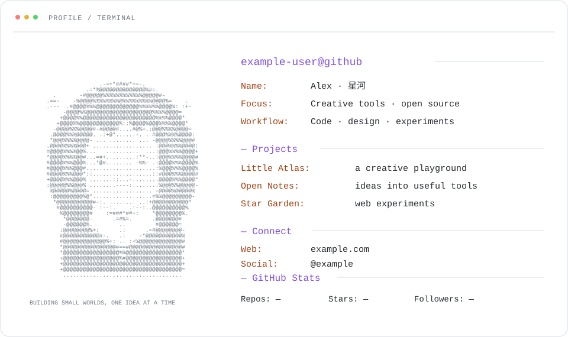

# GitHub Profile Terminal Skill

用一张头像和几条个人信息，生成终端风格的 GitHub 个人主页。把它交给 Codex、Claude Code 等支持 Agent Skills 的工具，就可以让 AI 帮你准备、预览和发布。



> 这是虚构资料生成的示例。头像、文字、链接、配色和公开统计都可以换成自己的。

## 能做什么

- 将本地头像转换为字符画，生成浅色/深色自适应的 SVG 卡片。
- 展示名称、关注方向、工作流、项目和联系方式，支持中文。
- 可选择蓝色、紫色或薄荷绿配色。
- 可选择加入 GitHub Actions，每天刷新公开仓库数、星标和关注者数。
- 生成完整的主页文件；原始头像不会被复制或上传。

## 安装 Skill

在终端运行：

```bash
npx skills add WoYun520/github-profile-skill --skill github-profile-terminal
```

按提示选择你使用的 AI 工具。安装后可以对它说：

> 用 github-profile-terminal 帮我做一个 GitHub 个人主页，头像用我提供的图片，项目展示这几个仓库。

然后提供 GitHub 用户名、头像及希望公开的项目和链接。如果你希望直接发布，也可以让它检查你的同名仓库并帮你部署。

## 手动生成

需要 Python 3；只有转换图片时需要安装 Pillow：

```bash
python3 -m pip install Pillow
```

复制 [`example-config.json`](skills/github-profile-terminal/assets/example-config.json)，修改用户名、项目、链接和其他资料，然后运行：

```bash
python3 skills/github-profile-terminal/scripts/create_profile.py \
  --config /path/to/my-config.json \
  --output /path/to/new-profile \
  --avatar-image /path/to/avatar.png \
  --auto-refresh
```

`--auto-refresh` 是可选项；去掉它即可不创建定时任务。`--fetch-stats` 可以在生成时读取一次公开统计，省略时先显示 `—`。不提供头像时会使用占位图。输出目录必须为空，避免覆盖已有文件。

将生成的文件放入公开的 `你的用户名/你的用户名` 仓库，README 就会出现在 GitHub 主页。已有同名仓库时，请先检查并合并已有内容。项目和联系方式链接在生成时写入 `README.md`，之后修改链接时也请更新 README。

## 统计口径

卡片只查询 GitHub 的公开数据。仓库数使用 GitHub 返回的公开仓库总数；星标默认汇总个人名下公开仓库并排除 GitHub 标记的 fork，可通过 `include_forks` 改变。普通镜像仓库不一定标记为 fork，可以把仓库名加入 `excluded_repos`。自动更新使用仓库内置的 `GITHUB_TOKEN`，不需要创建个人访问令牌；工作流需要仓库内容写权限。

## 修改与测试

```bash
python3 -m unittest discover -s tests -v
```

Agent Skill 位于 [`skills/github-profile-terminal`](skills/github-profile-terminal)，示例配置和模板在其中。代码采用 [MIT License](LICENSE)。

---

**English:** An Agent Skill for generating a personalized, terminal-style GitHub profile with an ASCII avatar, project links, theme presets, and an optional public-statistics refresh. Install with the command above; see the example configuration and generator help for standalone use.
